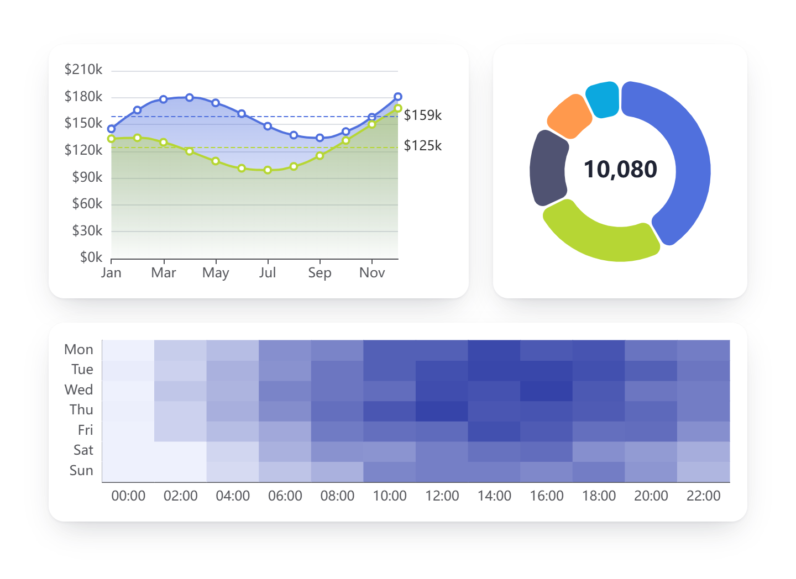

# Apache ECharts for Oracle APEX

16 chart types in one region type, from line, bar and pie to sankey, network and candlestick, drawn with Apache ECharts 6.1.0.



**[Live demo](https://oracleapex.com/ords/r/aamirkhanz/plugins/echarts)**: sign in as `demo` with the password `Demo`.

| | |
|---|---|
| **Type** | Region plug-in |
| **Internal name** | `COM.TECHREVX.ECHARTS` |
| **Version** | 1.2 |
| **Live demo** | [oracleapex.com/ords/r/aamirkhanz/plugins/echarts](https://oracleapex.com/ords/r/aamirkhanz/plugins/echarts) (user `demo`, password `Demo`) |
| **Requires** | Oracle APEX 26.2 or later |
| **License** | MIT |

## What it does

Apache ECharts draws interactive charts from any region source: a SQL query, a table or a REST source. Pick one of 16 chart types, from line and bar to sankey, network and candlestick, map your columns, and switch on the options you need. Page Designer shows only the columns and options that the chosen chart type uses.

Every chart can have a title, light, dark or custom theme, legend, tooltip, data labels, zoom, a toolbox to save the chart as an image, and a value format mask. Any other Apache ECharts setting can be added as JavaScript in ECharts Options.

## At a glance

- **Chart types**: Line, Bar, Pie, Scatter / Bubble, Heatmap, Tree, Treemap, Calendar, Gauge, Funnel, Radar, Sankey, Sunburst, Network Graph, Candlestick and Box Plot.
- **Source**: any region source (SQL query, table, REST source). Map columns in the Data group: Label, Value, Series, Y Category / Target, ID, Parent ID, Size, Color, and Open, High and Low for candlesticks. Page Designer shows only the columns and options the chosen Chart Type uses.
- **Options**: title, theme (automatic light/dark, also following a light/dark switch on the page without a reload, or custom), renderer, palette, legend, tooltip, data labels, animation, mouse and slider zoom, accessibility patterns, toolbox (save image, data view, box zoom, switch type, restore), value format mask and suffix, axis titles, limits, log and time axes, and per-type options for every chart type.
- **ECharts Options**: any other Apache ECharts option as a JavaScript object, merged over the generated options (echarts.apache.org/en/option.html).
- Initialization JavaScript Function: function( options, context ) receives the final options (and context.chart, context.rows, context.config) and may change or return them.
- **Refresh**: apex.region( "id" ).refresh() re-reads the data; Page Items to Submit, Faceted Search and Smart Filters are supported. apex.region( "id" ).getChart() returns the echarts instance.
- **Events**: ECharts - Click fires on a click with this.data = { name, value, seriesName, dataIndex, chartType, ... }; Set Item on Click stores the clicked name in a page item.

## Installation

1. Download `plugin/region_type_plugin_com_techrevx_echarts.sql` from the [latest release](https://github.com/aamirkhanz/apex-plugin-echarts/releases/latest) (or from this repository).
2. In App Builder, open your application and go to **Shared Components > Plug-ins**.
3. Choose **Import**, select the file and finish the wizard.
4. Create a region of type **Apache ECharts [Plug-in]**, write the query and choose the chart type and columns.

Everything the plug-in needs is inside the SQL file, including Apache ECharts; it loads nothing from other sites.

## Example

Monthly revenue per year as a line chart:

```sql
select to_char( order_date, 'Mon' ) as month,
       to_char( order_date, 'YYYY' ) as year,
       sum( amount )                 as revenue
  from orders
 group by to_char( order_date, 'Mon' ), to_char( order_date, 'YYYY' ),
          to_char( order_date, 'MM' )
 order by to_char( order_date, 'MM' ), year
```

```text
Chart Type      Line
Label Column    MONTH
Value Column    REVENUE
Series Column   YEAR
Show            Legend, Tooltip, Animation
Line Options    Smooth, Gradient Area
```

Rows come out in the order of the query, so sort by the category. When a UNION query starts with NULL in a column, cast it, for example `cast( null as number ) as parent_id`.

## Attributes

### Chart

| Attribute | Type | Default | Description |
|---|---|---|---|
| **Chart Type** (required) | Select list | `bar` | The kind of chart. Page Designer shows only the data columns and options that the chosen type uses. Values: `line` Line, `bar` Bar, `pie` Pie, `scatter` Scatter / Bubble, `heatmap` Heatmap, `tree` Tree, `treemap` Treemap, `calendar` Calendar, `gauge` Gauge, `funnel` Funnel, `radar` Radar, `sankey` Sankey, `sunburst` Sunburst, `graph` Network Graph, `candlestick` Candlestick, `boxplot` Box Plot. |
| **Height** (required) | Integer | `400` | Height of the chart in pixels. The width always follows the region. |
| **Title** | Text |  | Title drawn inside the chart (also used as the file name of Save as Image). Supports substitutions such as &P1_YEAR. |
| **Subtitle** | Text |  | Smaller line under the title. Shown when Title has a value. |
| **Title Alignment** (required) | Select list | `left` | Values: `left` Left, `center` Center, `right` Right. Shown when Title has a value. |
| **Theme** (required) | Select list | `auto` | Color theme. Automatic picks Dark when the page uses a dark theme style. Custom uses the theme JSON set in the plug-in's Component Settings (create one with the ECharts Theme Builder). Values: `auto` Automatic, `default` Light, `dark` Dark, `custom` Custom (Component Settings). |
| **Renderer** (required) | Select list | `canvas` | Canvas is fastest for large data. SVG stays sharp when zoomed or printed and uses less memory for small charts. Values: `canvas` Canvas, `svg` SVG. |
| **Color Palette** | Text |  | Comma-separated colors used in order for series, slices and nodes. Leave empty to use the theme's palette. |

### Data

| Attribute | Type | Default | Description |
|---|---|---|---|
| **Label Column** (required) | Region source column |  | Line and Bar: the category (x axis, or y axis for horizontal bars). Pie: the slice name. Scatter: the x value. Heatmap: the x category. Tree, Treemap and Sunburst: the node name. Calendar and Candlestick: the date. Gauge, Funnel and Box Plot: the name or category. Radar: the measure (spoke). Sankey and Network Graph: the source node. |
| **Value Column** | Region source column |  | The number to plot. Scatter: the y value. Candlestick: the close. Box Plot: one raw observation per row. Sankey and Network Graph: the size of the link. Tree: optional, shown in the tooltip. Rows with the same label and series are added up (except Box Plot). |
| **Series Column** | Region source column |  | Optional. One line, bar group, point color or radar shape per distinct value, for example a region or product line. Network Graph: the category (color) of the source node. Shown when Chart Type is `line` or `bar` or `scatter` or `radar` or `graph`. |
| **Y Category / Target Column** | Region source column |  | Heatmap: the category on the y axis, for example the weekday. Sankey and Network Graph: the target node of the link from the Label Column. Shown when Chart Type is `heatmap` or `sankey` or `graph`. |
| **ID Column** | Region source column |  | Unique key of each node. Required for a tree; for a treemap leave ID and Parent empty to draw a flat list. Shown when Chart Type is `tree` or `treemap` or `sunburst`. |
| **Parent ID Column** | Region source column |  | Key of the node's parent. Rows with an empty or unknown parent are top-level nodes; several top-level nodes are grouped under one root named after the Title. Shown when Chart Type is `tree` or `treemap` or `sunburst`. |
| **Size Column** | Region source column |  | Optional. Turns the scatter into a bubble chart: bubble area follows this value, up to Symbol Size. Shown when Chart Type is `scatter`. |
| **Color Column** | Region source column |  | Optional. A CSS color per row (for example #e5484d or rgb(0,128,0)) that overrides the palette for that bar, slice, point or node. Shown when Chart Type is `bar` or `pie` or `scatter` or `tree` or `treemap` or `funnel` or `sunburst` or `gauge`. |
| **Open Column** | Region source column |  | Opening value of each candle. Value Column is the close. Shown when Chart Type is `candlestick`. |
| **High Column** | Region source column |  | Highest value of each candle (the top of the wick). Shown when Chart Type is `candlestick`. |
| **Low Column** | Region source column |  | Lowest value of each candle (the bottom of the wick). Shown when Chart Type is `candlestick`. |
| **Maximum Rows** (required) | Integer | `10000` | Upper limit of rows read from the source. Aggregate in SQL for large tables. |

### Display

| Attribute | Type | Default | Description |
|---|---|---|---|
| **Show** | Checkboxes | `legend:tooltip:animation` | Legend: names of the series (Line, Bar, Scatter) or slices (Pie). Tooltip: details on hover. Data Labels: values on the chart. Animation: animate on load and refresh. Zoom with Mouse: wheel and drag zoom on the axes. Zoom Slider: a range slider below the chart. Patterns: adds textures to colors for color-blind readers. Values: `legend` Legend, `tooltip` Tooltip, `labels` Data Labels, `animation` Animation, `zoomInside` Zoom with Mouse, `zoomSlider` Zoom Slider, `decal` Patterns (Accessibility). |
| **Legend Position** (required) | Select list | `bottom` | Values: `top` Top, `bottom` Bottom, `left` Left, `right` Right. Shown when Chart Type is `line` or `bar` or `pie` or `scatter` or `funnel` or `radar` or `graph`. |
| **Legend Type** (required) | Select list | `scroll` | Scroll pages through long legends with arrows; Plain wraps them onto more lines. Values: `scroll` Scroll, `plain` Plain. Shown when Chart Type is `line` or `bar` or `pie` or `scatter` or `funnel` or `radar` or `graph`. |
| **Toolbox** | Checkboxes |  | Buttons in the top-right corner. Switch Type (Line and Bar only) toggles line, bar and stacked. Box Zoom works on Line, Bar, Scatter and Heatmap. Values: `saveAsImage` Save as Image, `dataView` Data View, `dataZoom` Box Zoom, `magicType` Switch Type, `restore` Restore. |
| **Data Label Position** | Select list |  | Where Data Labels are drawn. Automatic picks the usual place for the chart type (top of lines and bars, outside pie slices). Values: `top` Top, `inside` Inside, `insideTop` Inside Top, `insideBottom` Inside Bottom, `left` Left, `right` Right, `outside` Outside (Pie), `center` Center (Donut). |
| **Value Format Mask** | Text |  | Oracle number format mask for values in tooltips, labels and the value axis, formatted in the user's language. Leave empty for plain numbers. |
| **Value Suffix** | Text |  | Text added after every formatted value, for example % or kg. Include a leading space if you want one. |
| **Set Item on Click** | Page item |  | Page item set to the clicked element's name (category, slice, node or date) before the ECharts - Click event fires. Use a Dynamic Action on that event or on the item to drill down. |

### Axes

| Attribute | Type | Default | Description |
|---|---|---|---|
| **X Axis Title** | Text |  | Shown when Chart Type is `line` or `bar` or `scatter` or `heatmap` or `candlestick` or `boxplot`. |
| **Y Axis Title** | Text |  | Shown when Chart Type is `line` or `bar` or `scatter` or `heatmap` or `candlestick` or `boxplot`. |
| **Axis Options** | Checkboxes | `gridLines` | Grid Lines: horizontal guide lines. Fit to Data: the value axis starts near the smallest value instead of zero. Logarithmic: log scale for the value axis. Time Axis: spaces dates by time instead of evenly (Label Column must be a date). Reverse: flips the value axis. Values: `gridLines` Grid Lines, `scale` Fit to Data, `log` Logarithmic, `time` Time Axis, `inverse` Reverse Value Axis. Shown when Chart Type is `line` or `bar` or `scatter`. |
| **Value Axis Minimum** | Text |  | A number, or dataMin to start at the smallest value. Leave empty for automatic. Shown when Chart Type is `line` or `bar` or `scatter` or `gauge` or `candlestick` or `boxplot`. |
| **Value Axis Maximum** | Text |  | A number, or dataMax to end at the largest value. Leave empty for automatic. Shown when Chart Type is `line` or `bar` or `scatter` or `gauge` or `radar` or `candlestick` or `boxplot`. |
| **Category Label Rotation** | Integer |  | Rotates the category labels, from -90 to 90. Useful for long names. Overlapping labels are hidden automatically. Shown when Chart Type is `line` or `bar` or `scatter` or `heatmap` or `candlestick` or `boxplot`. |

### Series Options

| Attribute | Type | Default | Description |
|---|---|---|---|
| **Line Options** | Checkboxes | `symbols` | Values: `smooth` Smooth, `step` Step, `area` Area, `gradient` Gradient Area, `stack` Stacked, `percent` 100% Stacked, `symbols` Show Symbols, `connectNulls` Connect Gaps, `endLabel` Series Name at Line End, `markMax` Mark Maximum, `markMin` Mark Minimum, `markAverage` Average Line. Shown when Chart Type is `line`. |
| **Bar Options** | Checkboxes |  | Values: `horizontal` Horizontal, `stack` Stacked, `percent` 100% Stacked, `rounded` Rounded Corners, `background` Bar Background, `sort` Sort by Value, `markMax` Mark Maximum, `markMin` Mark Minimum, `markAverage` Average Line. Shown when Chart Type is `bar`. |
| **Bar Width** | Text |  | Width of each bar in pixels or as a percentage of the category. Leave empty for automatic. Shown when Chart Type is `bar`. |
| **Pie Options** | Checkboxes | `percent` | Donut: a hole in the middle. Rose: slices sized by radius (Nightingale). Half Donut: a 180 degree gauge-like donut. Total in Center: the sum in the donut hole. Values: `donut` Donut, `rose` Rose (Nightingale), `half` Half Donut, `gaps` Gaps Between Slices, `rounded` Rounded Slices, `percent` Percentages in Labels, `total` Total in Center, `select` Select on Click. Shown when Chart Type is `pie`. |
| **Radius** | Text |  | Outer radius, or inner and outer radius separated by a comma, in % of the chart or in pixels. Leave empty for automatic. Shown when Chart Type is `pie`. |
| **Scatter Options** | Checkboxes |  | Ripple: animated rings around each point. Large Data: faster drawing for tens of thousands of points (no per-point hover effects). Values: `ripple` Ripple Effect, `large` Large Data Mode. Shown when Chart Type is `scatter`. |
| **Symbol** | Select list |  | Values: `circle` Circle, `emptyCircle` Empty Circle, `rect` Square, `roundRect` Rounded Square, `triangle` Triangle, `diamond` Diamond, `pin` Pin, `arrow` Arrow, `none` None. Shown when Chart Type is `line` or `scatter` or `tree`. |
| **Symbol Size** | Integer |  | Size of points and markers. For bubbles (Size Column) this is the largest bubble. Shown when Chart Type is `line` or `scatter` or `tree`. |
| **Tree Layout** (required) | Select list | `lr` | Values: `lr` Left to Right, `rl` Right to Left, `tb` Top to Bottom, `bt` Bottom to Top, `radial` Radial. Shown when Chart Type is `tree`. |
| **Tree Options** | Checkboxes | `curved:expand` | Values: `curved` Curved Lines, `expand` Expand and Collapse on Click, `roam` Pan and Zoom. Shown when Chart Type is `tree`. |
| **Initial Depth** (required) | Integer | `2` | Number of levels shown expanded at first. Use -1 to expand everything. Shown when Chart Type is `tree`. |
| **Treemap Options** | Checkboxes | `breadcrumb:zoom:upperLabels` | Zoom on Click: clicking a node zooms into it; the breadcrumb goes back. Parent Labels: a header strip with the name of each parent. Shade by Level: deeper levels get lighter colors. Values: `breadcrumb` Breadcrumb, `zoom` Zoom on Click, `roam` Pan and Zoom, `upperLabels` Parent Labels, `saturation` Shade by Level. Shown when Chart Type is `treemap`. |
| **Visible Depth** | Integer |  | Number of levels shown at once; deeper levels appear when you zoom in. Leave empty to show all levels. Shown when Chart Type is `treemap`. |
| **Date Range** | Text |  | A year (2026), a month (2026-03) or a start and end separated by a comma. Leave empty to use the dates in the data; several years are drawn as stacked calendars. Shown when Chart Type is `calendar`. |
| **Calendar Options** | Checkboxes | `yearLabel:mondayFirst` | Values: `bubbles` Bubbles Instead of Cells, `vertical` Vertical, `yearLabel` Year Label, `monthLines` Month Borders, `mondayFirst` Week Starts on Monday. Shown when Chart Type is `calendar`. |
| **Cell Size** | Integer |  | Size of each day cell. Leave empty to fit the calendar to the region width. Shown when Chart Type is `calendar`. |
| **Gauge Options** | Checkboxes | `progress:pointer` | Progress Arc: colors the arc up to the value. Pointer: a needle. Scale: ticks and numbers around the dial. Rings: one concentric ring per row, like activity rings. Half Circle: a 180 degree dial. The dial runs from Value Axis Minimum to Maximum (default 0 to 100). Values: `progress` Progress Arc, `pointer` Pointer, `scale` Scale, `rings` Rings, `half` Half Circle. Shown when Chart Type is `gauge`. |
| **Funnel Options** | Checkboxes | `gaps:percent` | Pyramid: widest at the bottom. Percent of First Stage: labels show the conversion from the first stage. Values: `pyramid` Pyramid, `gaps` Gaps Between Stages, `percent` Percent of First Stage. Shown when Chart Type is `funnel`. |
| **Radar Options** | Checkboxes | `area` | The spokes end at Value Axis Maximum, or a little above the largest value. Values: `area` Filled Area, `circle` Circular Grid, `symbols` Show Symbols. Shown when Chart Type is `radar`. |
| **Sankey Options** | Checkboxes | `gradient` | Gradient Links: links blend from the source color to the target color. Align Left: nodes line up from the left instead of spreading over the width. Values: `vertical` Vertical, `gradient` Gradient Links, `alignLeft` Align Left. Shown when Chart Type is `sankey`. |
| **Sunburst Options** | Checkboxes | `zoom:ancestors` | Zoom on Click: clicking a ring segment makes it the center; click the center to go back. Highlight Path: hovering highlights the segment and its parents. Values: `zoom` Zoom on Click, `ancestors` Highlight Path, `sort` Sort by Value, `radialLabels` Radial Labels. Shown when Chart Type is `sunburst`. |
| **Network Options** | Checkboxes | `force:draggable:roam` | Force Layout: nodes push each other apart and links pull them together; without it nodes sit on a circle. Arrows: draws links as directed. Node size follows the total value of its links. Values: `force` Force Layout, `draggable` Drag Nodes, `roam` Pan and Zoom, `arrows` Arrows. Shown when Chart Type is `graph`. |

### Color Scale

| Attribute | Type | Default | Description |
|---|---|---|---|
| **Scale Options** | Checkboxes | `handles` | Value ranges in steps: a legend of value bands instead of a gradient. Drag Handles: filter the visible range with handles. Hide Scale: color the cells without showing the scale. Values: `piecewise` Value Ranges in Steps, `handles` Drag Handles, `hide` Hide Scale. Shown when Chart Type is `heatmap` or `calendar`. |
| **Low Value Color** (required) | Color | `#e3e8fb` | Shown when Chart Type is `heatmap` or `calendar`. |
| **High Value Color** (required) | Color | `#3442a8` | Shown when Chart Type is `heatmap` or `calendar`. |

### Advanced

| Attribute | Type | Default | Description |
|---|---|---|---|
| **ECharts Options** | JavaScript |  | Any Apache ECharts option as a JavaScript object, merged over the options built from the attributes above. This reaches every setting in the ECharts option reference (echarts.apache.org/en/option.html), including functions. A series given as an object (not an array) applies to every series; an array merges by position. |

### Component Settings

| Attribute | Type | Default | Description |
|---|---|---|---|
| **Custom Theme** | JavaScript |  | Theme object used by charts with Theme set to Custom. Build one at echarts.apache.org/en/theme-builder.html, download it as JSON and paste the JSON here. |

## Events

Available in Dynamic Actions, and as jQuery events on the region or item:

- **ECharts - Click** (`tx-echarts-click`)

## Events

Create a Dynamic Action on the chart region with the event **ECharts - Click [Apache ECharts]**. In its actions, `this.data` describes what was clicked:

```text
{
    chartType:  "bar",        // the region's Chart Type
    name:       "North",      // category, slice, node, date, or the series of a scatter point
    value:      1250,         // the number behind it (raw value for 100% stacked bars)
    seriesName: "2026",
    dataIndex:  0,
    x, y                      // heatmap categories, scatter coordinates
}
```

Set Item on Click stores `name` in a page item before the event fires, so a Dynamic Action on that item's Change event works too. The region also fires the standard **Before Refresh** and **After Refresh** events.

```javascript
// Execute JavaScript Code action of an ECharts - Click Dynamic Action
apex.message.showPageSuccess( this.data.name + ": " + this.data.value );
```

## JavaScript

### apex.region( "id" ).refresh()

Reads the rows again through the plug-in and redraws the chart. Items in Page Items to Submit are sent first. A Refresh Dynamic Action does the same.

### apex.region( "id" ).getChart()

Returns the Apache ECharts instance, for anything the ECharts API offers: `dispatchAction` to highlight or select, `getDataURL` to export, `on` for other events.

```javascript
var chart = apex.region( "sales" ).getChart();
chart.dispatchAction( { type: "highlight", seriesIndex: 0, dataIndex: 2 } );
chart.on( "legendselectchanged", function( p ) { console.log( p.selected ); } );
```

### Initialization JavaScript Function

Runs before every draw (first load and each refresh) with the finished options. Change them in place or return a new object. The second argument has the echarts instance (`chart`), the rows and the attribute values (`config`).

```javascript
function( options, context ) {
    // label the highest bar
    options.series[ 0 ].markPoint = { data: [ { type: "max" } ] };
    // format axis labels yourself
    options.yAxis.axisLabel.formatter = function( v ) { return v / 1000 + "k"; };
    return options;
}
```

## ECharts Options

The ECharts Options attribute takes a JavaScript object with any setting from the [Apache ECharts option reference](https://echarts.apache.org/en/option.html). It is merged over the options the plug-in builds:

- objects merge key by key, so you only write what you change;
- a `series` object (not an array) applies to every series; an array merges by position;
- functions are allowed, for example formatters.

```text
{
    // log scale on the x axis of a scatter chart
    xAxis: { type: "log", min: 1000 },
    // dashed grid lines
    yAxis: { splitLine: { lineStyle: { type: "dashed" } } },
    // every series: thicker lines and a shadow
    series: { lineStyle: { width: 3 }, emphasis: { focus: "series" } },
    // a watermark
    graphic: [ { type: "text", right: 20, bottom: 20, style: { text: "Draft", fill: "#ccc" } } ]
}
```

### Custom theme

Design a theme with the [ECharts Theme Builder](https://echarts.apache.org/en/theme-builder.html), download it as JSON and paste it into the plug-in's Component Settings (Custom Theme). Charts with Theme set to Custom use it.

## Included libraries

| Library | Version | License |
|---|---|---|
| [Apache ECharts](https://echarts.apache.org) | 6.1.0 | Apache-2.0 |

See [THIRD-PARTY-NOTICES.md](THIRD-PARTY-NOTICES.md).

## Repository contents

- `plugin/region_type_plugin_com_techrevx_echarts.sql`: the plug-in, ready to import
- `src/`: the plug-in's own source (PL/SQL in `plugin.pls`, JavaScript and CSS), for reading and reviewing; the SQL file already contains it
- `apexplugin.json`: the plug-in's details for [apex.world](https://apex.world)

## License

MIT, see [LICENSE](LICENSE). The included libraries keep their own licenses.

## More plug-ins

Documentation, updates and more plug-ins for Oracle APEX: [www.techrevx.com](https://www.techrevx.com)
